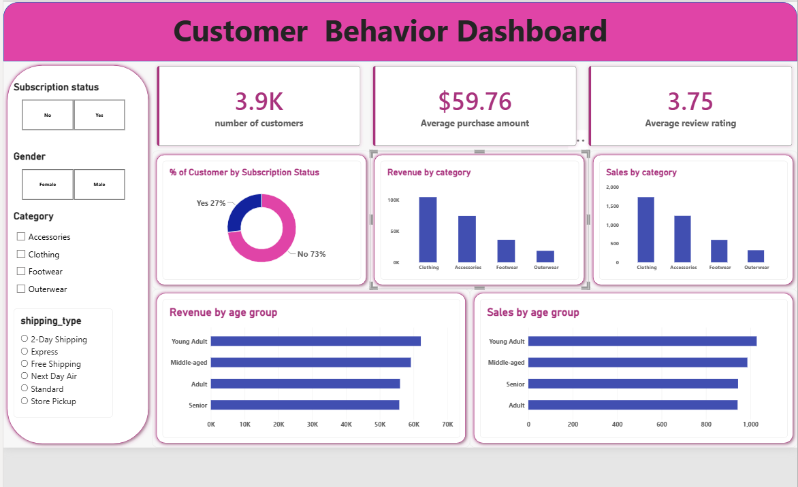

# Customer Behaviour Analysis | Python, SQL & Power BI

##  Project Overview
This project analyzes customer purchasing patterns, demographics, and product preferences to uncover actionable insights that help improve customer retention and boost sales.

##  Tools & Technologies Used
* **Python (Pandas, NumPy, Matplotlib):** Data cleaning, handling missing values, and Exploratory Data Analysis (EDA).
* **SQL:** Querying customer segments, calculating repeat purchase rates, and aggregating revenue metrics.
* **Power BI:** Creating custom DAX measures and building an interactive dashboard with KPIs and dynamic filters.

##  Key Insights Uncovered
* **Top Customer Segment:** Identified the primary age group and gender contributing the highest share of total revenue.
* **Product & Category Trends:** Highlighted top-performing product categories and seasonal buying patterns.
* **Customer Retention & Churn:** Analyzed repeat vs. one-time buyers to pinpoint key factors driving customer loyalty.

##  Project Screenshots

### Power BI Dashboard

### DAX Measures

### SQL Queries & Output

### Python Analysis

